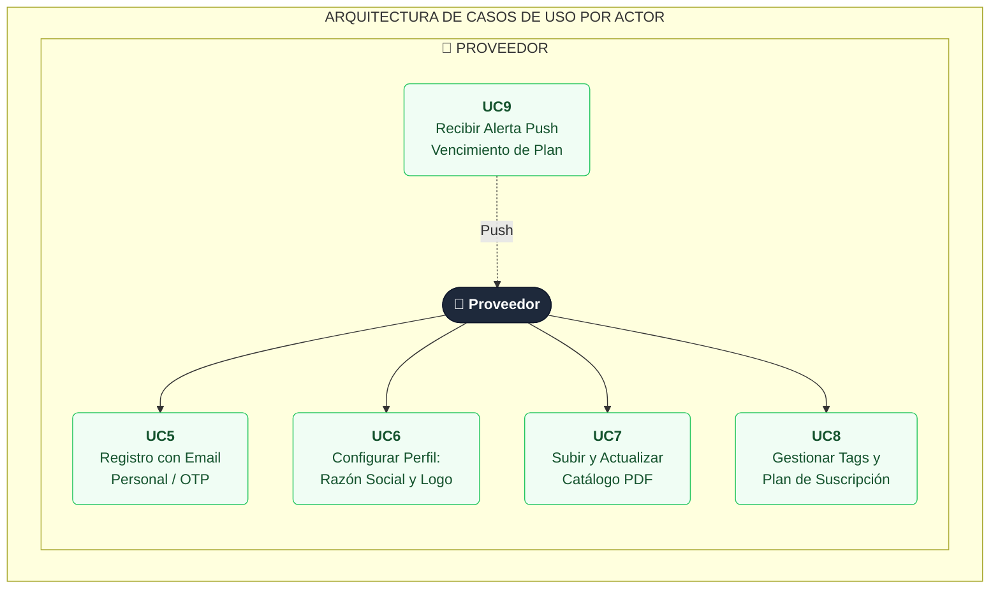

# DistroYaProvider
DistroYaProvider
- UC5: Registro con Email Personal / OTP 
- UC6: Configurar Perfil: Razón Social, Logo y Contacto 
- UC7: Subir y Actualizar Catálogo en formato PDF 
- UC8: Seleccionar / Gestionar Tags y Plan de Suscripción  
- UC9: Recibir Alerta Push de Vencimiento de Plan

# Caso de Usos

